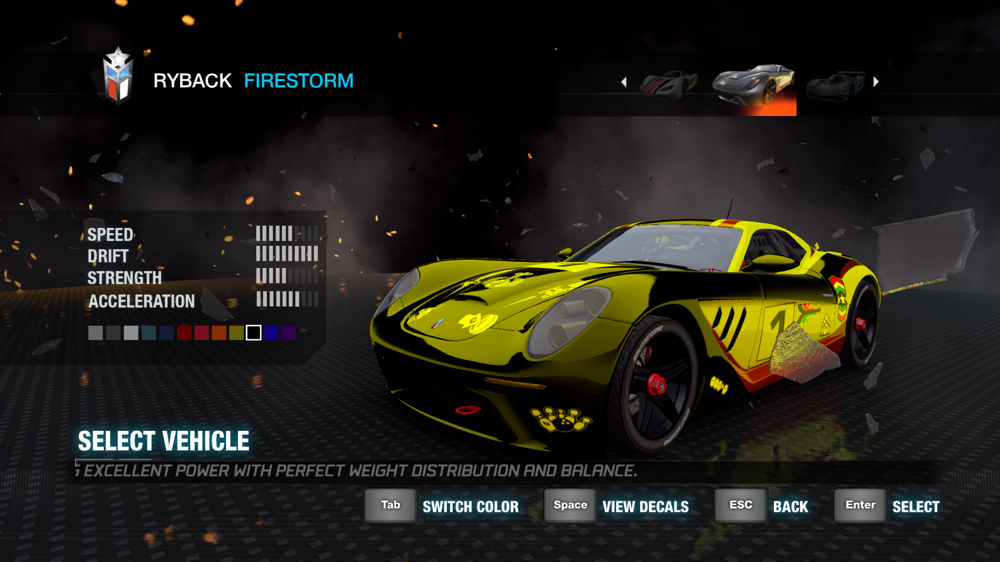
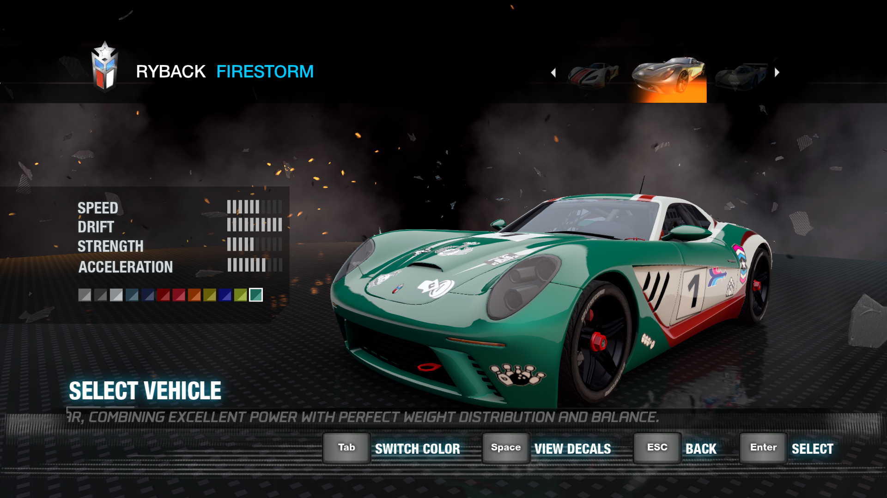
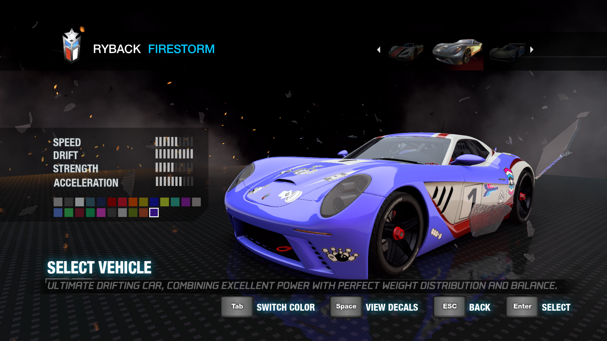

# Split/Second — Color Palette Patcher

Two paired patchers for **Split/Second** that lift the per-car colour limit and
show every swatch in the garage / vehicle-select screen.

| Script | Target | What it changes |
| --- | --- | --- |
| `ppl.py` | `SplitSecond.exe` | Data side — raises the number of colour palettes a car can hold from the stock **9** to `N`. |
| `gfx_swatches.py` | `Fe_VehicleSelect.gfx` | Display side — raises the number of swatch slots shown from the stock **12** to `N`. |

They are independent files but work together: the exe must store more than 9
palettes **and** the GFX must know how to draw more than 12 swatches. Keep the
same `N` in both.

---

## Build support

- **`ppl.py`** targets the **Cracked Retail / DC** builds of `SplitSecond.exe`.
  It byte-verifies every patch site and aborts (without writing) if the exe is
  not in the expected stock state, so it is safe to point at an unknown exe.
- **`gfx_swatches.py`** operates on the GFX file itself (whose structure is
  fixed), so it is build-independent.

Both scripts default to a **dry run** — they only report. Add `--apply` to
write. A backup is created next to each target before the first patch.

---

## Requirements

- Python 3.8+ (no third-party packages).
- A **clean / stock** `SplitSecond.exe` (Cracked Retail or DC build) — an
  already-patched exe will correctly be reported as "not in the expected state".
- `Fe_VehicleSelect.gfx` from the game's `Deferred/UI/frontend/Flash/` folder.

---

## Quick start

### 1. Patch the executable (data side)

```bat
REM Dry run: check the build and print the plan
python ppl.py "D:/Game/SplitSecond.exe" -n 24

REM Apply
python ppl.py "D:/Game/SplitSecond.exe" -n 24 --apply
```

`-n` is the new palette capacity (stock is 9, valid range 1–255). A backup is
written to `SplitSecond.exe.orig` on the first apply.

### 2. Patch the vehicle-select GFX (display side)

```bat
python gfx_swatches.py "D:/Game/Deferred/UI/frontend/Flash/Fe_VehicleSelect.gfx" -n 24 --apply
```

Up to **70 slots** (5 rows × 14) fit into the stock panel without extending it;
this is the default safe ceiling. See [docs/how-gfx-works.md](docs/how-gfx-works.md)
for the grid layout options if you want to go higher.

### 3. Capacity vs. display (they do NOT have to match)

`N` means something different in each tool:

- **`ppl.py`** sets the **capacity** — the maximum number of palettes a car can
  hold without truncation. It is safe to go as high as 255; the game simply
  gains the potential to store that many colours.
- **`gfx_swatches.py`** sets how many slots are **visible/clickable** in the
  menu. Pick a value that fits the panel: the default safe range is **12–70**.

The exe can be patched to 255 while the GFX shows, say, 24 slots — the stored
colours beyond the visible slots are just not shown (they are not corrupted).
Choose the GFX count by the panel layout, not by the exe capacity.

---

## Documentation

- [docs/how-ppl-works.md](docs/how-ppl-works.md) — the exe patch: root cause,
  struct layout, the 13 patch sites, verification.
- [docs/how-gfx-works.md](docs/how-gfx-works.md) — the GFX patch: ActionScript
  limits, SWF/GFX container, grid layout, panel growth, configuration.

---

## Screenshots

Before patches — a colour beyond the stock 9 is broken/truncated:



After the executable patch (`N = 24`) only: colour 12 is now correct, but the
screen still shows only 12 slots:



After both patches: all 24 slots are shown and clickable:



---

## Managing `VehicleColors.params`

These patchers raise the capacity/display limits, but the actual colour data
lives in the game's `VehicleColors.params` file (at
`Deferred/Vehicles/VehicleColors.params`). To edit that file — add or remove
palettes per car, randomize colours, copy whole galleries between cars, and save
your work — use the companion editor:

- **VehCol-Tool (Split/Second Vehicle Colors Editor)**
  → <https://github.com/theUssa1n/SplitSecond-VehicleColors-Tool>

Together the three pieces make a complete chain: VehCol-Tool builds a
`VehicleColors.params` with more palettes per car, `ppl.py` lets the executable
store them without truncation, and `gfx_swatches.py` makes the vehicle-select
menu show every swatch.

---

## License

Copyright (c) 2026 Ussa1n. Released under the [MIT License](LICENSE).
